

<h2>Hi 👋</h2>

I’m a computer science engineering student at INSA Lyon, with a strong interest in software engineering. 
*Currently on an academic exchange at the University of Sherbrooke, Canada 🍁*

Here are some projects:

## &nbsp; Web pages & tools

<table>
<tr>
<td width="50%" valign="top">
<a href="https://github.com/gabinollier/gatsun-website">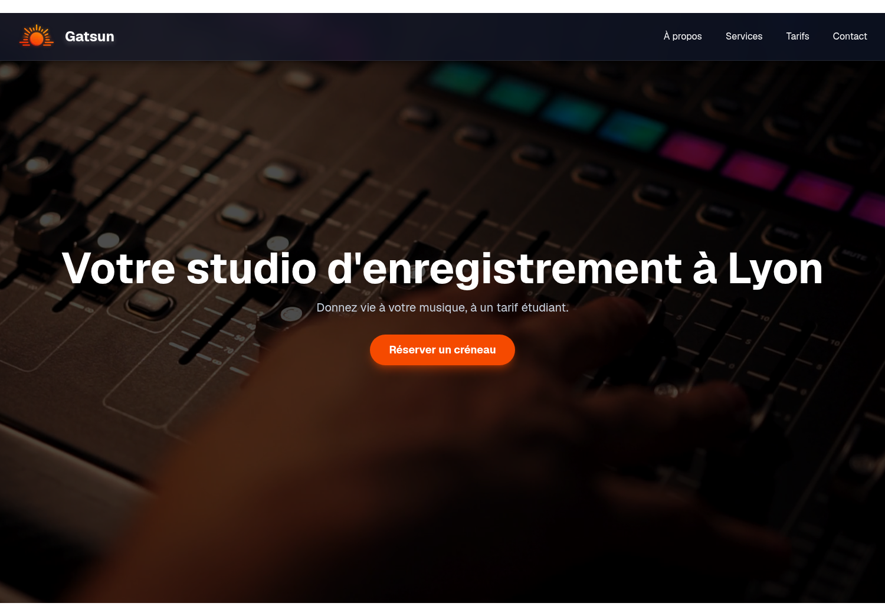</a>

<b><a href="https://github.com/gabinollier/gatsun-website">Gatsun</a></b>
The website & internal booking calendar for INSA Lyon's student recording studio (<a href="https://www.gatsun.fr">gatsun.fr</a>).
Next.js · PostgreSQL · Docker

</td>
<td width="50%" valign="top">
<a href="https://github.com/gabinollier/arbre-de-parrainage">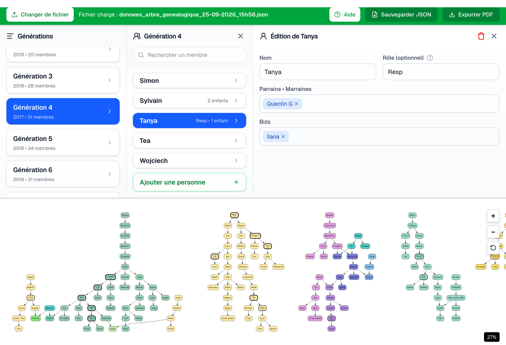</a>

<b><a href="https://github.com/gabinollier/arbre-de-parrainage">Arbre de Parrainage</a></b>
An interactive editor for complex student lineages, with automatic graph layout algorithms & PDF export.
TypeScript · Graphviz (WASM) · jsPDF

</td>
</tr>
<tr>
<td width="50%" valign="top">
<a href="https://github.com/gabinollier/koda-landing-page">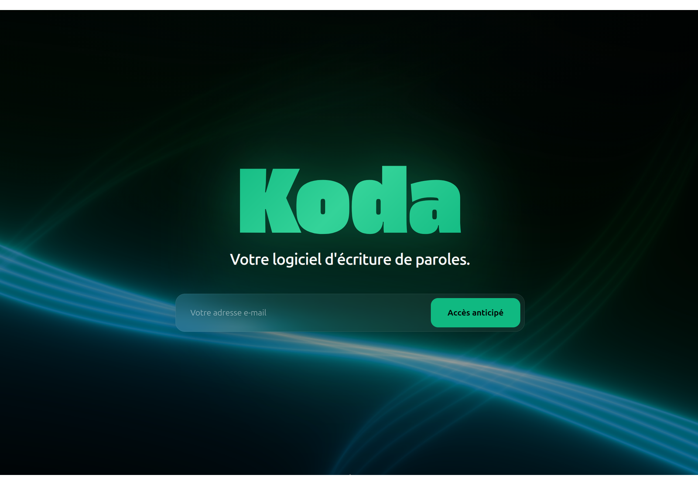</a>

<b><a href="https://github.com/gabinollier/koda-landing-page">Koda</a></b>
A landing page for Koda, a local-first lyrics writing app I'm building.
Electron · Supabase · PowerSync · TensorFlow

</td>
<td width="50%" valign="top">
<a href="https://github.com/gabinollier/srt-checker">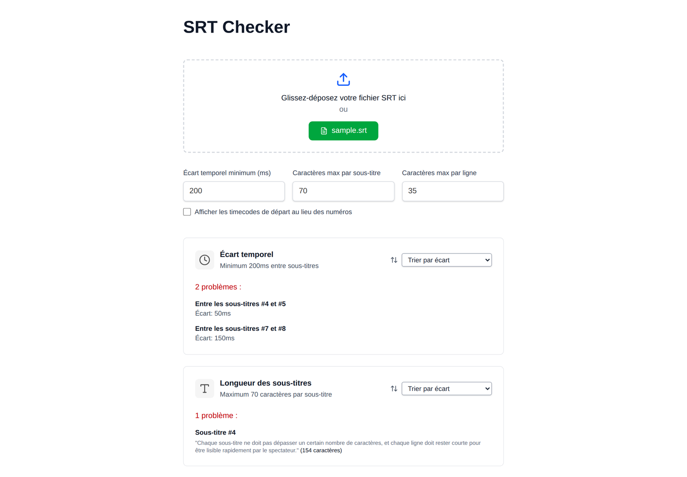</a>

<b><a href="https://github.com/gabinollier/srt-checker">SRT Checker</a></b>
A tool to validate .srt subtitle files against readability rules (timing, line & block lengths).
TypeScript · Tailwind CSS

</td>
</tr>
</table>

## &nbsp;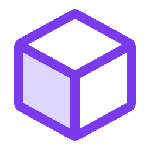 3D & games

<table>
<tr>
<td width="50%" valign="top">
<a href="https://github.com/gabinollier/unity-voxel-game">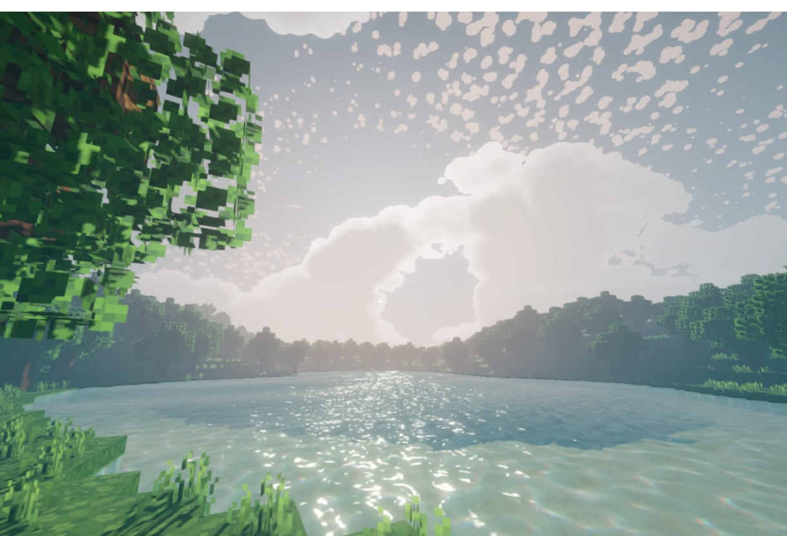</a>

<b><a href="https://github.com/gabinollier/unity-voxel-game">Unity Voxel Game</a></b>
A multithreaded Minecraft-like voxel game, focused on visuals & atmosphere.
C# · Unity · URP

</td>
<td width="50%" valign="top">
<a href="https://github.com/gabinollier/racing-game">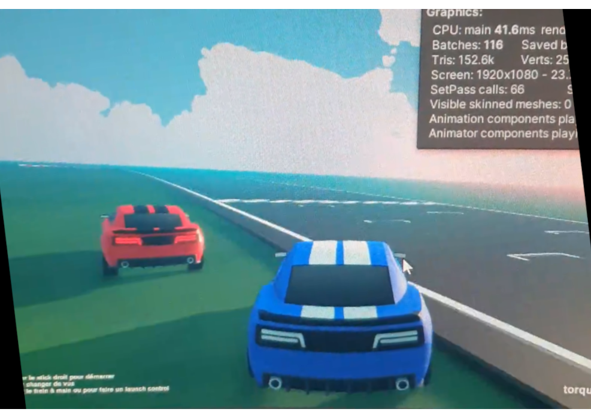</a>

<b><a href="https://github.com/gabinollier/racing-game">Racing Game</a></b>
A Unity racing game for experimenting with Reinforcement Learning.
C# · Unity · ML-Agents · Python

</td>
</tr>
</table>

## &nbsp; Audio

<table>
<tr>
<td width="50%" valign="top">
<a href="https://github.com/gabinollier/mini-synth">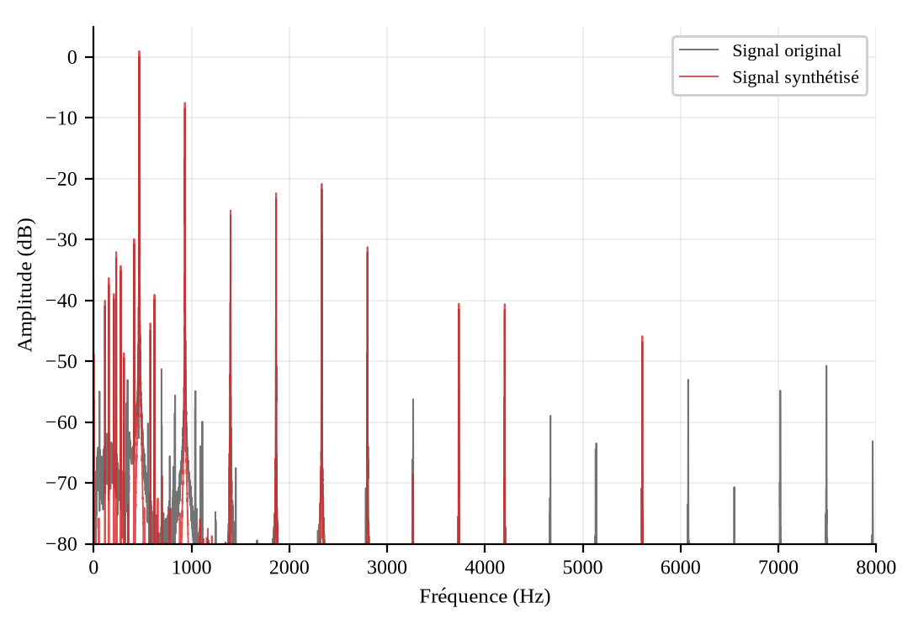</a>

<b><a href="https://github.com/gabinollier/mini-synth">Mini Synth</a></b>
A really simple Python synth: decomposes a sound into its sinusoids and envelope, then re-synthesizes whole melodies, including from MIDI files.
Python · NumPy · SciPy · Matplotlib

</td>
<td width="50%" valign="top">
<a href="https://github.com/gabinollier/parametric-air">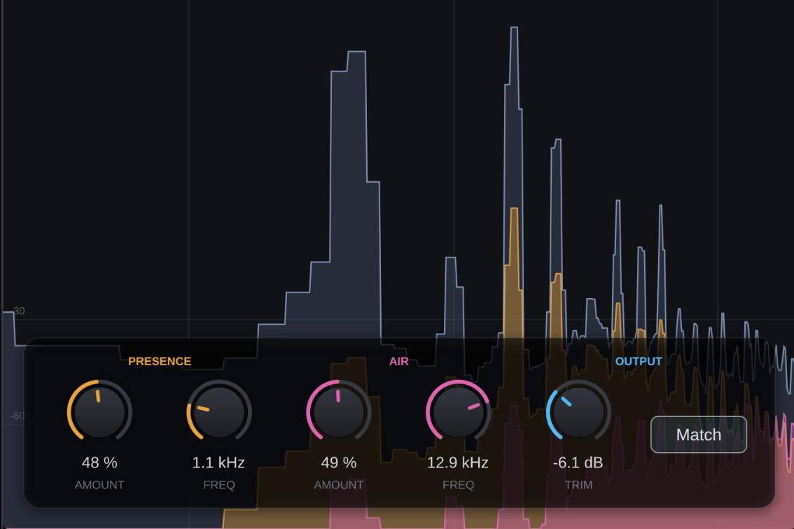</a>

<b><a href="https://github.com/gabinollier/parametric-air">ParametricAir</a></b>
My first audio plugin: adds presence & air with parallel compression and a real-time spectrum display.
C++ · JUCE · DSP

</td>
</tr>
</table>

## &nbsp; Also building

<table>
<tr>
<td width="50%" valign="top">
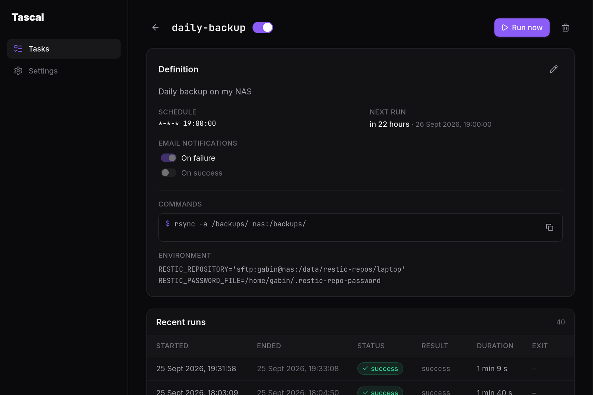

<b>Tascal</b>
A user-friendly UI to create, run & monitor scheduled tasks on top of <code>systemd</code> timers. I use it to schedule my backups and send myself an email if something goes wrong.
Rust · React · Linux

</td>
<td width="50%" valign="top">

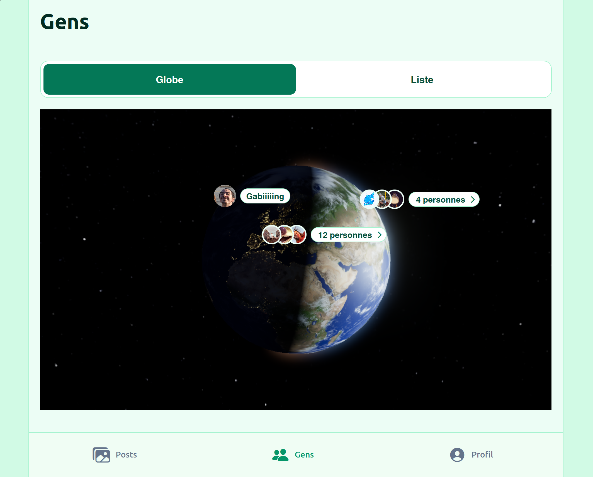

<b>Get Lag</b>
A complete private social network for students on exchange: posts, reactions, profiles, and more. Has a <a href="https://play.google.com/store/apps/details?id=com.gabinlucas.getlag">mobile app</a> and a <a href="https://getlag.gabinollier.com">web app</a>. Private for now, shared with ~20 friends.
React Native · Expo · Supabase · S3 · Docker

</td>
</tr>
</table>

…and more experiments in my repositories.

