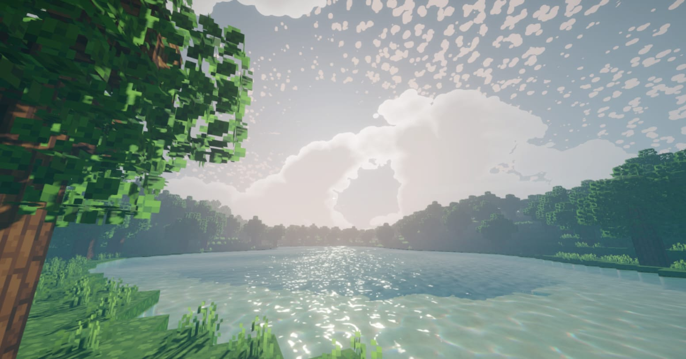

<h2>Hi 👋</h2>

I’m a computer science engineering student at INSA Lyon, with a strong interest in software engineering. 
*Currently on an academic exchange at the University of Sherbrooke, Canada 🍁*

Here are some projects:

## 🌐 Web pages & tools

<table>
<tr>
<td width="50%" valign="top">
  
<b>Gatsun</b> — website & internal booking calendar for INSA Lyon's student recording studio (<a href="https://www.gatsun.fr">live</a>). 
Next.js · PostgreSQL · Docker
</td>
<td width="50%" valign="top">
  
<b>Arbre de Parrainage</b> — interactive editor for complex student sponsorship trees, with automatic graph layout & PDF export. 
TypeScript · Graphviz (WASM) · jsPDF
</td>
</tr>
<tr>
<td width="50%" valign="top">
  
<b>Koda</b> — landing page of Koda, a lyrics-writing app I'm building. 
Next.js · Three.js · Tailwind CSS
</td>
<td width="50%" valign="top">
  
<b>SRT Checker</b> — web app to validate .srt subtitle files against readability rules (timing, line & block lengths). 
Next.js · TypeScript · Tailwind CSS
</td>
</tr>
</table>

## 🎮 3D & games

<table>
<tr>
<td width="50%" valign="top">
  
<b>Unity Voxel Game</b> — multithreaded Minecraft-like voxel game, focused on visuals & atmosphere. 
C# · Unity · URP
</td>
<td width="50%" valign="top">
  
<b>Racing Game</b> — Unity racing game where an AI learns to drive with reinforcement learning (ML-Agents). 
C# · Unity · ML-Agents · Python
</td>
</tr>
</table>

## 🎧 Audio

<table>
<tr>
<td width="50%" valign="top">
  
<b>Mini Synth</b> — Python synth: decomposes a sound into sinusoids + envelope, then re-synthesizes whole melodies (including from MIDI files). 
Python · NumPy · SciPy · Matplotlib
</td>
<td width="50%" valign="top">
  
<b>ParametricAir</b> — my first audio plugin: adds presence & air with parallel compression and a real-time spectrum display. 
C++ · JUCE · DSP
</td>
</tr>
</table>

## 🔨 Also building

<table>
<tr>
<td width="50%" valign="top">
  
<b>Tascal</b> — clean web UI to create, run & monitor scheduled tasks on top of systemd timers, shipped as a single self-contained binary. (closed-source for now) 
Rust · React · systemd
</td>
<td width="50%" valign="top">
  
<b>Get Lag</b> — social app for students on exchange: weekly photo themes, reactions & streaks. (closed-source for now) 
React Native (Expo) · Supabase
</td>
</tr>
</table>

…and more experiments (including an ESP32 rocket 🚀) on <a href="https://github.com/gabinollier?tab=repositories">my GitHub</a>.

